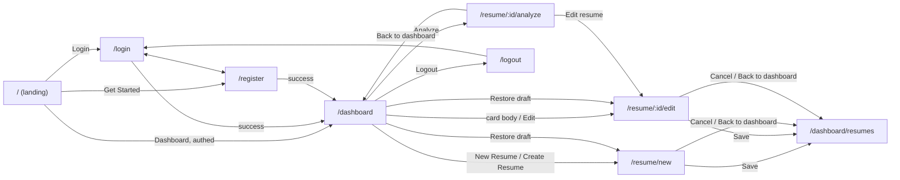

# User Flow

Step-by-step journeys through ResumeAI, including every branch. Routes come from the base spec ([resume-optimizer-frontend-spec.md](resume-optimizer-frontend-spec.md) → "Routing"), plus `/logout` and the 404 page.
Behavior details are referenced by ID from [functional-requirements.md](functional-requirements.md).

---

## 1. Route map

| Route                   | Access     | Layout        | Page                             |
| ----------------------- | ---------- | ------------- | -------------------------------- |
| `/`                     | any        | LandingLayout | Landing (marketing page)         |
| `/login`                | guest only | PublicLayout  | Login                            |
| `/register`             | guest only | PublicLayout  | Register                         |
| `/privacy-policy`       | any        | PublicLayout  | PrivacyPolicy                    |
| `/terms-and-conditions` | any        | PublicLayout  | TermsAndConditions               |
| `/dashboard`            | protected  | AppLayout     | Dashboard (Overview)             |
| `/dashboard/resumes`    | protected  | AppLayout     | MyResumes                        |
| `/dashboard/drafts`     | protected  | AppLayout     | Drafts                           |
| `/resume/new`           | protected  | AppLayout     | ResumeNew                        |
| `/resume/:id/edit`      | protected  | AppLayout     | ResumeEdit                       |
| `/analyze`              | protected  | AppLayout     | AnalyzePicker (choose a resume)  |
| `/resume/:id/analyze`   | protected  | AppLayout     | Analyze                          |
| `/logout`               | protected  | —             | Logout (logs out, then `/login`) |
| `*`                     | any        | PublicLayout  | NotFound                         |

- **Guest only:** an authenticated user is redirected to `/dashboard`.
- **Protected:** with no session, the user is redirected to `/login`.

---

## 2. First-time user

1. The user opens the app at `/`. They aren't authenticated, so they're sent to `/login` (theme follows the OS).
2. They click "Don't have an account? **Register**" and go to `/register`.
3. They fill in name, email, password and confirm password, then submit.
   - **Validation fails:** inline errors appear, and focus moves to the first invalid field. They stay on the page.
   - **API error** (e.g. email taken): an error toast shows the API message. The form stays filled.
4. **Success:** the session is stored, the app navigates to `/dashboard`, and the **register welcome toast** appears ([FR-GREET-01](functional-requirements.md#fr-greet-01-welcome-toast)).
5. The dashboard shows skeletons, then the **empty state**: "You have no resumes yet. Start by creating one!" with **Create Resume**.
6. They click Create Resume and go to `/resume/new` (Section 4).

## 3. Returning user

1. `/` (or any URL). If a stored session exists, `/` goes to `/dashboard`, and protected URLs open directly.
2. **No session:** `/login`. They enter email and password, then submit.
   - Wrong credentials: toast with the API message. Never "session expired".
   - Success: `/dashboard` + **login welcome toast**. Always the dashboard, even if they originally requested another page.
3. On the dashboard:
   - **Drafts exist** and the banner isn't dismissed: the banner "You have N unsaved draft(s)." appears (Section 8).
   - **Resumes exist:** a grid of cards, newest first.
   - **Load fails:** an error panel with **Retry**, plus a toast.

## 4. Create a resume

1. The user arrives at `/resume/new` from Navbar New Resume, the empty state's Create Resume, or Restore draft (Section 8).
2. The page shows "← Back to dashboard", the heading "Create resume", the StepIndicator (1 of 6) and **Step 1: Contact Details**. Name is pre-filled from the account.
3. On each step:
   - **Next:** validate the current step.
     - Invalid: inline errors, focus on the first invalid field, stay.
     - Valid: push a history entry and fade to the next step.
   - **Back** (in-app or browser): go to the previous step. No validation.
   - **Browser Back on Step 1**, **Cancel**, **Back to dashboard**, **Navbar links**, **Logout**:
     - If not dirty: navigate away.
     - If dirty: the **Discard modal** appears ("Discard unsaved changes?").
       - **Discard:** continue the navigation.
       - **Keep editing** / Esc: stay, with focus returned to the trigger.
   - **Refresh or close tab** while dirty: the browser's native leave prompt. After a refresh, the builder restarts empty at Step 1.
4. **Steps 3, 4 and 6 (array sections):** they start empty. The user clicks "Add …" to add entry cards, and removes entries with the trash icon.
5. **Step 5 Skills, and Step 6 tech:** type and press Enter (or Add). Duplicates are rejected inline.
6. **Step 6:** **Save Resume**. The app validates all steps, then calls `createResume`.
   - **Success:** `/dashboard/resumes` + toast "Resume saved successfully." The new card appears first.
   - **API error:** toast. They stay on Step 6 with their data.
   - **Session expired:** see Section 9.
7. **Navbar New Resume while already on `/resume/new`:**
   - If dirty: Discard modal. On confirm, the form resets to Step 1.
   - If clean: nothing happens.

## 5. Edit a resume

1. The user arrives at `/resume/:id/edit` from a card body click, a card's **Edit** button, Analyze's **Edit resume**, or Restore draft.
2. Skeleton, then `getResume(id)`.
   - **404/403:** `/dashboard` + toast "Resume not found."
   - **Other error:** `/dashboard` + toast with the API message.
3. The form loads pre-filled at **Step 1** (heading "Edit resume").
4. Navigation is the same as in Section 4. In addition, a save button is on every step: **Save Changes** (outlined) on Steps 1–5 and **Save Resume** (filled) on Step 6.
   - **All steps valid:** `updateResume`. Success: `/dashboard/resumes` + "Resume saved successfully."
   - **An earlier step is invalid:** toast "Please complete all required fields", and the form jumps to the first invalid step with its errors shown.
5. Cancel, Back to dashboard and the other exits behave as in Section 4.

## 6. Analyze a resume

1. The user arrives at `/resume/:id/analyze` from a card's **Analyze** button.
2. Skeletons, then `getResume` and `getAnalyses` load in parallel.
   - **Resume 404/403:** `/dashboard` + "Resume not found."
   - **Analyses fail:** the form works, and the result/history area shows an error panel with **Retry**.
3. The page contains:
   - "← Back to dashboard"
   - "Analyze: {title}"
   - **Edit resume**
   - the job description form
   - the **current result**: the most recent past analysis if one exists, otherwise "No analysis yet…"
   - **Previous analyses**: up to 5, excluding the current one.
4. **Paste a job description.** The counter updates (`n / 5,000`). Analyze is enabled at ≥ 50 characters.
5. **Click Analyze.**
   - The form is disabled and the button shows "Analyzing…". At 10 s, "This is taking longer than usual, please wait..." appears.
   - **Success:** the new result replaces the current one, history refreshes (the old current moves to the top of history), the job description text stays, and focus moves to the result.
   - **Timeout (30 s):** toast "The request timed out. Please try again." The form is re-enabled.
   - **Other error:** toast with the API message.
6. **Expand a history row** to see the full past result. Several rows can be open at once.
7. **Export PDF** (current result only): jsPDF loads and the file downloads as `{title}-analysis-{YYYY-MM-DD}.pdf`.
   - Generation fails: toast "Couldn't generate the PDF. Please try again."
8. Leaving the page:
   - **Edit resume** goes to `/resume/:id/edit`.
   - **Back to dashboard** or the Navbar go elsewhere, with no unsaved-changes guard on this page.

## 7. Delete a resume

1. On the dashboard, the user clicks the card's **Delete**. The modal "Delete resume?" opens with focus on Cancel.
2. **Cancel** or Esc: the modal closes and focus returns to the Delete button.
3. **Delete:** the button shows "Deleting…" and the modal stays open.
   - **Success:** the modal closes, the card is removed, the resume's draft is removed, and the toast "Resume deleted." appears.
   - **Failure:** the modal closes and an error toast appears. The card stays.

## 8. Drafts

1. A draft exists after a session expired mid-edit (Section 9).
2. After logging in, Overview shows the banner "You have 1 unsaved draft." with **View drafts** and an **X**.
   - **X:** the banner hides until another draft is saved.
   - **View drafts:** goes to `/dashboard/drafts`.
3. **Drafts page:** cards with the title (or "Untitled resume"), "Saved 3 hours ago", **Restore** and **Discard**.
   - **Discard:** the draft is deleted and the toast "Draft discarded." appears.
   - **Restore** (create draft): `/resume/new` loads the draft data at its **saved step**.
   - **Restore** (edit draft): `/resume/:id/edit` checks the resume exists.
     - **Exists:** the draft data loads at its saved step.
     - **Gone (404/403):** the draft is deleted, the user goes to `/dashboard`, and the toast "Resume no longer exists." appears.
4. **In a restored session:**
   - The form counts as dirty from the start.
   - **Save:** the resume is saved, the draft is deleted, the user goes to `/dashboard/resumes` and sees the success toast.
   - **Leaving through the Discard modal** ("Discard this draft?"): confirming deletes the draft.
5. **Automatic cleanup:**
   - drafts older than 30 days are removed;
   - with more than 10 drafts, the oldest is removed;
   - each resume has at most one draft.

## 9. Session expiry

1. Any authenticated request returns 401. Usually this happens while saving in the builder or loading a page.
2. If the builder is open **and dirty**, a draft is saved (data, step, mode, resume id).
3. The user is logged out, and the app goes straight to `/login` without the discard modal. The toast "Session expired. Please log in again." appears once.
4. The user logs in, lands on `/dashboard` and sees the drafts banner (Section 8).

## 10. Logout

1. The user clicks Navbar **Logout** (icon-only on mobile).
   - **In a dirty builder:** the Discard modal appears first. **Keep editing** cancels the logout.
2. The app goes to `/logout`: the session is cleared, the toast "You've been logged out." appears, and the user is sent to `/login`.

## 11. Not found

1. The user opens any unknown URL. The 404 page renders inside the public layout (logo and ThemeToggle only).
2. It shows "Page not found. This page doesn't exist or was moved." The link is **Go to dashboard** (if logged in) or **Go to login** (if not).

## 12. Theme

Available on every page from the Navbar. One click switches the theme and remembers it. With no saved choice, the theme follows the OS.

## 13. App crash

If a render error occurs, the full-screen fallback "Something went wrong." appears. **Reload** reloads the page.
